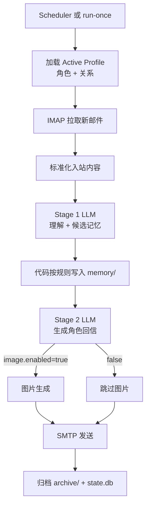
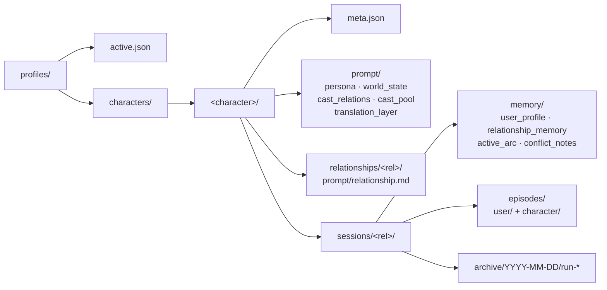

# dropline

> 一个本地运行的 AI 虚拟人物邮件系统 — 让 AI 角色通过**真实邮箱**与你保持长期通信。

🌏 English: [README.md](README.md)

[](https://github.com/Asnly1/dropline/actions/workflows/ci.yml)


---

## ✨ 项目亮点

- 📬 **真实邮箱通信** — IMAP/SMTP 拉取和发送,不是临时聊天窗口,随时可翻阅邮件记录
- 👥 **Profile-First 结构** — 每个"角色 × 关系"组合拥有独立的 prompt、记忆、归档
- 🧠 **双阶段 LLM pipeline** — Stage 1 理解来信并提炼候选记忆,Stage 2 以角色口吻写回信
- 🖼️ **可选图片生成** — Stage 2 产出 `scene_card`,由独立图片 provider 渲染,失败则整次运行中断
- ⏰ **跨平台定时调度** — macOS `launchd` / Windows Task Scheduler 一键安装
- 🔒 **本地存储、可审计** — 运行状态用 SQLite;长期记忆和 episode 都是纯 JSON 文件,人类可读、可手工修改

> ⚠️ **隐私提示 ——「本地」指存储,不指处理。** dropline **不是**本地模型方案:每次运行都会把**来信正文、你的记忆文件、角色 prompt** 发送给你所配置的外部 LLM / 图片 provider(OpenAI、Gemini、Anthropic 等)。只有存储留在你本机,请选用你信任的 provider 来处理这些内容。

---

## 🏗️ 工作原理

每一次 pipeline 的完整生命周期:



设计要点:

- **LLM 提议,代码决策**:Stage 1 只输出候选记忆,真正写入哪个文件由本地代码按 [docs/memory_promotion_rules.md](docs/memory_promotion_rules.md) 决定
- **图片是硬门槛**:若启用图片生成且失败,本轮运行中断,memory 不受污染(设 `llm.image.on_failure=text_only` 可改为降级成纯文本发信)
- **归档留痕**:每次运行的输入、Stage 1/2 输出、生成的图片都保存在 `archive/YYYY-MM-DD/run-*/`

> 📬 **看真实运行:** [**examples/conversation_keqing.cn.md**](examples/conversation_keqing.cn.md) 完整走一遍刻晴的 `init-once` 主动来信 + 第一轮一来一回——附每轮真实生成的配图,以及每封回信背后 Stage 1 记忆候选的可折叠「幕后」。([English](examples/conversation_keqing.en.md))

---

## 📂 Profile 结构

角色、关系、会话三层目录,彼此独立:



- `profiles/active.json` 指向当前生效的角色 + 关系
- 每个 **session = 角色 × 关系**,切换不同关系就是一个全新记忆空间
- CLI 默认按"角色名 + 关系描述"交互,slug 只是内部目录键

---

## 🚀 快速开始

### 环境要求

- Python `>= 3.12`
- 一个可开启 IMAP/SMTP 授权码的邮箱(QQ / Gmail / 163 等)作为**角色邮箱**
- 至少一家 LLM provider 的 API key

### 安装

```bash
git clone <this-repo>
cd dropline
python3 -m pip install -e ".[dev]"
```

如果你已经在使用 `uv`,也可以等价执行:

```bash
uv pip install -e ".[dev]"
```

安装后可以直接运行 `dropline ...`,也可以继续使用 `python3 -m dropline ...`。
开发验证命令:

```bash
python3 -m pytest
```

### 配置

仓库根目录自带一份占位符 `config.example.yaml`,复制并编辑它即可。

```bash
cp config.example.yaml config.yaml   # 可选:保留一份私有配置副本
# 然后手动修改 config.yaml
```

#### 核心配置

dropline 会用到**两个**邮箱,首次运行前都要配好:

- **角色邮箱** — 一个真实、专用的邮箱账号,AI 用它登录来读取你的来信、发送回信。请给角色单独开一个账号,不要复用你的私人邮箱。
- **你的收件箱**(`primary_user_recipient`)— 角色的来信投递到这里。你写信 _发给_ 角色邮箱,角色 _回信_ 给你。

`allowlist_senders` 是一道硬门槛:任何不在列表中的发件人来信都会被忽略,因此只有你能联系到角色。

```yaml
mail:
  allowlist_senders:
    - "you@example.com" # 只处理这些发件人的来信
  primary_user_recipient: "you@example.com" # 回信投递到这里(你自己的收件箱)
  character_mailbox:
    address: "character@example.com"
    imap:
      host: "imap.example.com"
      port: 993
      ssl: true
      username: "character@example.com"
      password: "APP_PASSWORD" # 邮箱授权码,不是登录密码
      folder: "INBOX"
    smtp:
      host: "smtp.example.com"
      port: 465
      security: "ssl"
      username: "character@example.com"
      password: "APP_PASSWORD"

project:
  timezone: "America/Los_Angeles" # IANA 时区名;锚定下方的调度时间窗
```

如果你想把真实配置留在本地而不进入公开仓,可以继续维护 `config.yaml`,并在运行时显式传 `--config /绝对/路径/config.yaml`。
如果这份私有配置文件不在仓库根目录下,必须在 `project` 里显式指定真实仓库根目录:

```yaml
project:
  repo_root: "/absolute/path/to/dropline-repo"
```

未配置 `project.repo_root` 时,兼容旧行为:配置文件所在目录会被当作仓库根目录。

SMTP 加密方式使用明确枚举:

```yaml
mail:
  character_mailbox:
    smtp:
      security: "ssl" # ssl | starttls | none
```

`ssl` 表示直连 SMTP_SSL,`starttls` 表示普通 SMTP 连接后升级 STARTTLS,`none` 表示不启用传输层加密。

如果你想统一控制模型输出的文本语言,可以在 `llm` 下增加 `language`:

```yaml
llm:
  language: "简体中文"
  stage1:
    provider: "openai"
  stage2:
    provider: "openai"
  image:
    enabled: true
    provider: "openai"
```

`llm.language` 会固定 Stage 1、Stage 2、`generate-character`、`generate-relationship`、`scene_card` 的文本输出语言,并让最终图片 prompt 跟随目标语言。当前只接受精确值 `简体中文` 和 `English`。

如果只想发送文字邮件,把 `llm.image.enabled=false`:

```yaml
llm:
  image:
    enabled: false
```

关闭后会完全跳过图片生成,Stage 2 不再要求输出 `scene_card`,邮件只发送正文,也不会调用图片 provider。

邮件正文按纯文本发送。Stage 2 使用 `body` 字段输出正文;不会渲染 Markdown。HTML alternative 只做转义、换行和段落包装。

### 生成第一个角色 + 关系

```bash
# 动漫/游戏角色:附带作品名
python3 -m dropline generate-character --character "刻晴" --work "原神"

# 现实公众人物:不填作品名,自动走"公开形象优先"模式
python3 -m dropline generate-character --character "某位作家"

# 生成关系 prompt
python3 -m dropline generate-relationship \
    --character "刻晴" \
    --relationship "青梅竹马,久别重逢,通信克制但熟悉"
```

### 运行一次 pipeline

```bash
# 选中 active profile(会自动创建 session)
python3 -m dropline select --character "刻晴" --relationship "青梅竹马"

# 初始化 session 的 memory 和 state.db
python3 -m dropline init-state

# 立即跑一次完整流程(拉信 → 理解 → 写回信 → 发送 → 归档)
python3 -m dropline run-once
```

> ⚠️ 首次运行语义:第一次 `run-once` 不会处理历史来信,只会建立首封主动邮件;首封主动邮件之前已经收到的来信可能不会进入对话。

> 💡 如果不想记命令参数,直接 `python3 -m dropline` 进入交互式 CLI,输命令名后会自动追问所需参数。

---

## 🧠 记忆系统

session 的记忆分 6 类,Stage 1 只负责**提议**,代码负责**裁决**是否写入:

| 文件 / 目录                       | 类型       | 典型内容                                 |
| --------------------------------- | ---------- | ---------------------------------------- |
| `memory/user_profile.json`        | 稳定事实   | 用户长期目标、核心偏好(门槛最高)         |
| `memory/relationship_memory.json` | 关系约定   | 称呼、共同梗、关系定义                   |
| `memory/active_arc.json`          | 进行中主线 | 最近 7 天内反复出现、未解决(最多 1~2 条) |
| `episodes/user/*.json`            | 用户短期   | 日常心情、临时烦恼(14~30 天后降权)       |
| `episodes/character/*.json`       | 角色短期   | 角色本次处理的事务                       |
| `memory/conflict_notes.json`      | 冲突记录   | 新信息与旧记忆冲突,先入此处等待二次确认  |

这四个记忆文件和 episode 都是纯 JSON 数组,UTF-8 纯文本,可直接打开手工编辑;pipeline 每次运行后会重写它们。

晋升门槛严格:一次性情绪、未证实的推测、角色自行补充的细节**不得**晋升。完整规则见 [docs/memory_promotion_rules.md](docs/memory_promotion_rules.md)。

---

## ⏰ 定时调度

推荐模式:**定时拉起一次 `scheduler-tick`,由它自己判断是否到点**,而非常驻进程。

### 一键安装

```bash
python3 -m dropline install-scheduler --config /绝对/路径/config.yaml
python3 -m dropline uninstall-scheduler --config /绝对/路径/config.yaml
```

可选参数:

- `--task-name` 自定义任务名(默认 `dropline`)
- `--python` 指定 Python 解释器(默认跟随当前 `sys.executable`)
- `--no-load` 仅生成安装产物,不实际注册到系统

日志统一输出到:

- `runtime_logs/dropline.out.log`
- `runtime_logs/dropline.err.log`

触发逻辑:每 `schedule.check_every_minutes` 分钟唤起一次;不在时间窗口或未到每日目标发送时间则快速退出,到点则跑一次完整 pipeline。

完整调度配置项:

```yaml
schedule:
  enabled: true # 调度总开关
  window_start: "20:00" # 每天最早发送时间
  window_end: "23:59" # 每天最晚发送时间(设为小于 start 即跨午夜)
  daily_target_pick_time: "00:05" # 过了这个时间,dropline 才锁定当天的发送时刻
  check_every_minutes: 30 # OS 定时器多久唤起一次 scheduler-tick
```

每天的实际发送时刻会在时间窗口内**随机选取**(按日期固定),角色不会每天卡在同一分钟写信。

调度窗口支持跨午夜。例如:

```yaml
schedule:
  window_start: "22:00"
  window_end: "01:00"
```

这表示从目标日期当天 22:00 到次日 01:00。次日 01:00 之后不会继续补发这个窗口内的任务。

### macOS (launchd)

```bash
# 查看任务状态
launchctl print gui/$(id -u)/dropline

# 手动立即触发
launchctl kickstart -k gui/$(id -u)/dropline

# 手动卸载
launchctl bootout gui/$(id -u) ~/Library/LaunchAgents/dropline.plist
rm ~/Library/LaunchAgents/dropline.plist
```

### Windows (Task Scheduler)

```powershell
# 查看任务状态
schtasks /Query /TN "dropline" /V /FO LIST

# 手动立即触发
schtasks /Run /TN "dropline"

# 手动卸载
schtasks /Delete /TN "dropline" /F
```

---

## 🛠️ 故障处理与告警

无人值守运行时,dropline 会自己收住常见故障,并在需要人介入时发邮件告诉你。

### 失败后怎么重试

- **先退避,再重试**:一次 run 失败后,调度器至少等 `schedule.retry_after_minutes` 分钟才会再试(tick 日志事件 `skipped_backoff`);每天由调度器触发的 run 不超过 `schedule.max_runs_per_day` 次(`skipped_daily_limit`),手动 `run-once` 不受此限制;"昨日漏发补发"只会尝试 1 次(`catch_up_succeeded` / `catch_up_failed`)。成功一次后连续失败计数归零。
- **重试复用归档产物**:同一批次(同一 `batch_id`)重试时,若上次失败的 run 已归档 `stage2.json`,直接跳过 Stage 1 / Stage 2 进入配图和发信;若只有 `stage1.json`,则只重跑 Stage 2,且不会重复写入用户侧 episode。日志会写明复用了哪个 run 的产物(`reused_run_id=...`)。
- **来信隔离**:reply 模式的 run 在 stage1 / stage2 / validation / image 阶段失败时,本批来信的 `attempt_count` +1 并记录 `last_error`;达到 `schedule.max_batch_attempts` 次(Stage 2 校验失败只需 2 次)就被**隔离**(`quarantined_at`)。被隔离的来信不再进入批次,下一次 run 会恢复为主动来信模式,不会让一封坏信卡住整个角色。`show-inbox` 会标出 `QUARANTINED` 和 `last_error`;修好问题后用 `requeue-inbound --uid N` 放回队列,`delete-inbound --uid N` 也可以直接删掉它。
- **配图降级**:`llm.image.on_failure` 默认 `abort`(保持"图片是硬门槛");设为 `text_only` 时图片生成失败只记 WARNING,并在归档目录写 `image_failure.json`,邮件改为纯文本发送。
- **僵尸 run 自动收尾**:每次 `scheduler-tick` 开始时,`started_at` 早于 6 小时前且仍为 `running` 的 run 会被自动标为 `failed`(`error_stage=stale_running`);`mark-stale-runs-failed` 仍可手动处理更久远的记录。

### 查看状态

```bash
python3 -m dropline status --config /绝对/路径/config.yaml
```

输出当前 session 的最近一次成功 / 失败 run(run_id、阶段、错误信息)、连续失败次数、未消费与已隔离的来信数、pending 出站数、IMAP 游标(`last_seen_uid` / `last_consumed_uid`,以及 kv 里若存在的 `uidvalidity`)、今日调度状态(`scheduled_for_date` / `target_send_time` / `sent_time` / `runs_today`)和最近一次告警时间。

### 告警邮件

连续失败次数达到 `mail.alerts.after_failures`,或有来信被隔离时,dropline 会用角色邮箱给 `mail.alerts.recipient` 发一封**纯文本系统通知**:发件人显示名固定为 `dropline`(不是角色名),主题以 `[dropline] ` 开头,正文写明这是系统通知而非角色来信,包含失败阶段、错误信息和建议的下一步(看 `runtime_logs/`、`dropline status`、`requeue-inbound`)。同一天最多发一封;告警本身发送失败只记日志,不影响主流程。

相关配置项(都有默认值,可省略):

```yaml
schedule:
  retry_after_minutes: 120 # 失败后至少等多久再试
  max_runs_per_day: 3 # 调度器每天最多触发几次 run(run-once 不计)
  max_batch_attempts: 3 # 同一批来信最多尝试几次,之后隔离(validation 失败 2 次即隔离)

mail:
  alerts:
    enabled: true # 告警邮件总开关
    recipient: "you@example.com" # 默认等于 primary_user_recipient
    after_failures: 2 # 连续失败几次后告警

llm:
  image:
    on_failure: "abort" # abort | text_only
```

---

## 🔌 支持的 LLM Provider

| Provider        | 默认文本模型                   | 默认图片模型                 |
| --------------- | ------------------------------ | ---------------------------- |
| OpenAI          | `gpt-5.5`                      | `gpt-image-2-2026-04-21`     |
| Gemini          | `gemini-3.1-pro-preview`       | `gemini-3-pro-image-preview` |
| Anthropic       | `claude-opus-4-8`              | —                            |
| Grok            | `grok-4.20-0309-non-reasoning` | `grok-imagine-image-pro`     |
| Qwen (通义千问) | `qwen3-max-2026-01-23`         | `qwen-image-2.0-pro`         |
| Doubao (豆包)   | `doubao-seed-2-0-pro-260215`   | `doubao-seedream-5-0-260128` |
| DeepSeek        | `deepseek-v4-pro`              | —                            |
| GLM (智谱)      | `GLM-5.2`                      | —                            |

> 以上是 `config.yaml` 里预填的默认模型,你可以随时改 `<provider>.text_model` / `image_model` 切换到别的版本。

配置原则:

- `llm.stage1.provider` / `llm.stage2.provider` 决定**文本** provider
- `llm.image.provider` 决定**图片** provider
- 只需要配置当前 `llm.stage1.provider`、`llm.stage2.provider`,以及启用图片时的 `llm.image.provider`
- 当前文本 provider 需要 `api_key` 和 `text_model`;当前图片 provider 还需要 `image_model`
- 未使用 provider 块可以删除,也可以保留占位;缺 `api_key` / 模型字段不会阻塞启动,等切换 provider 时再补齐
- `llm.image.enabled=false` 时完全跳过图片生成,Stage 2 也不再要求输出 `scene_card`

---

## 📘 CLI 参考

进入交互式 CLI:

```bash
python3 -m dropline
```

<details>
<summary><b>完整命令清单</b></summary>

| 命令                                        | 说明                                                                       |
| ------------------------------------------- | -------------------------------------------------------------------------- |
| `list`                                      | 列出所有角色与关系                                                         |
| `show-active`                               | 显示当前 active profile                                                    |
| `show-inbox` / `show-outbox`                | 查看当前 session 的收/发件箱                                               |
| `generate-character`                        | LLM 生成角色 prompt(persona/world_state/…)                                 |
| `generate-relationship`                     | LLM 生成关系 prompt                                                        |
| `select`                                    | 选中角色 + 关系为 active,并创建 session                                    |
| `delete-session`                            | 删除目标 session 的 memory/episodes/archive;可用 `--yes` 跳过确认          |
| `delete-inbound`                            | 删除单条 inbound(`--uid`)或整箱清空(`--all`);可用 `--yes` 跳过确认         |
| `delete-outbound`                           | 删除单条 outbound(`--message-id`)或整箱清空(`--all`);可用 `--yes` 跳过确认 |
| `requeue-inbound`                           | 清除一封来信的隔离标记与失败计数(`--uid`),让它重新进入队列                 |
| `init-state`                                | 初始化当前 active session 的 memory 和 state.db                            |
| `run-once`                                  | 立即执行一次完整 pipeline                                                  |
| `scheduler-tick`                            | 执行一次调度检查,到点才跑 pipeline                                         |
| `mark-stale-runs-failed`                    | 把当前 active session 中超过指定天数仍为 running 的 run 标为 failed        |
| `status`                                    | 查看当前 session 的最近 run、失败计数、收/发件箱状态与今日调度              |
| `install-scheduler` / `uninstall-scheduler` | 安装 / 卸载系统定时任务                                                    |
| `reset-dev-state`                           | 清空所有 session、日志、数据库后按当前 active 重建;可用 `--yes` 跳过确认   |

</details>

## 📚 更多文档

- [examples/conversation_keqing.cn.md](examples/conversation_keqing.cn.md) — 一段真实的首轮通信(init-once + 第一轮),含配图与幕后
- [docs/run_pipeline.md](docs/run_pipeline.md) — Pipeline 每阶段的输入输出约定
- [docs/memory_promotion_rules.md](docs/memory_promotion_rules.md) — 记忆晋升的完整规则

---

## 📝 License

本项目基于 [MIT License](LICENSE) 开源 — 你可以自由使用、修改、分发,只需保留版权声明。
