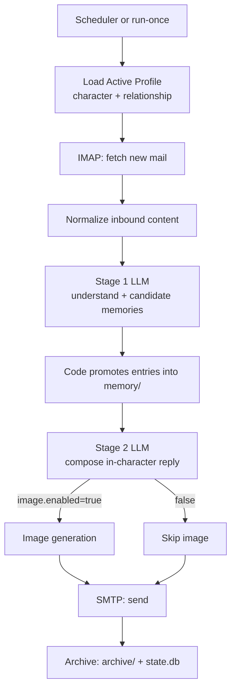
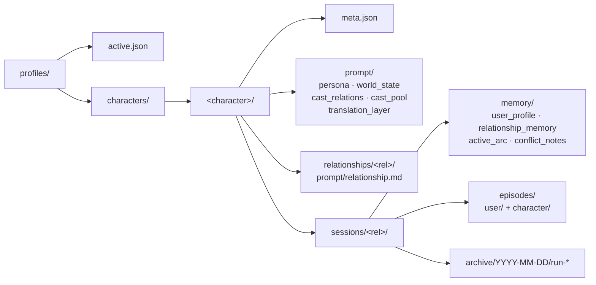

# dropline

> A locally-run AI virtual character mail system — let AI characters stay in touch with you through **real email inboxes**, long-term.

🌏 中文: [README.cn.md](README.cn.md)

[](https://github.com/Asnly1/dropline/actions/workflows/ci.yml)


---

## ✨ Highlights

- 📬 **Real email communication** — IMAP/SMTP driven, not a chat window. All correspondence lives in your mailbox forever.
- 👥 **Profile-first structure** — each `character × relationship` pair has its own prompts, memory, and archive.
- 🧠 **Two-stage LLM pipeline** — Stage 1 understands the incoming letter and extracts candidate memories; Stage 2 writes the reply in character.
- 🖼️ **Optional image generation** — Stage 2 produces a `scene_card` rendered by a separate image provider. Failures halt the run cleanly.
- ⏰ **Cross-platform scheduling** — one-command install for macOS `launchd` and Windows Task Scheduler.
- 🔒 **Local, auditable storage** — run state in SQLite; long-term memory and episodes are plain JSON files you can read and hand-edit.

> ⚠️ **Privacy — "local" means storage, not processing.** dropline is **not** a local-model setup. Every run sends the incoming mail body, your memory files, and the character prompts to whichever external LLM / image provider you configure (OpenAI, Gemini, Anthropic, …). Only storage stays on your machine — pick a provider you trust with that content.

---

## 🏗️ How it works

One full pipeline run, end to end:



Key design choices:

- **LLM proposes, code decides** — Stage 1 only emits _candidate_ memories. The decision of what gets written, and to which file, is made by local code following [docs/memory_promotion_rules.en.md](docs/memory_promotion_rules.en.md).
- **Image is a hard gate** — if image generation is enabled and fails, the run aborts and no email is sent. The user-side memory Stage 1 already wrote is kept; the character-side episode is not written.
- **Everything is archived** — inputs, Stage 1/2 outputs, and the generated image for each run are saved under `archive/YYYY-MM-DD/run-*/`.

> 📬 **See a real run:** [**examples/conversation_keqing.en.md**](examples/conversation_keqing.en.md) walks through the opening letter Keqing sends on the first `run-once` and the first round of back-and-forth — with the real generated images, and a collapsible look at the Stage 1 memory candidates behind each reply. ([中文版](examples/conversation_keqing.cn.md))

---

## 📂 Profile layout

Three-tier directory — character, relationship, session — each independent:



- `profiles/active.json` points to the currently active character + relationship.
- A **session** is uniquely identified by `character × relationship` — switching relationship gives you a brand-new memory space.
- The CLI matches a character by name, by `name / work title` (for example `刻晴 / 原神`) or by slug, and a relationship by name or slug. The relationship description is not used for matching.

---

## 🚀 Quickstart

### Requirements

- Python `>= 3.12`
- A mailbox (QQ / Gmail / 163 / etc.) with IMAP/SMTP app-password enabled — this becomes the **character's mailbox**
- An API key for at least one LLM provider

### Install

```bash
git clone <this-repo>
cd dropline
python3 -m pip install -e ".[dev]"
```

If you already use `uv`, this is also fine:

```bash
uv pip install -e ".[dev]"
```

After installation, you can run `dropline ...` directly or keep using `python3 -m dropline ...`.
For development checks:

```bash
python3 -m pytest
```

### Configure

The repo ships with a placeholder `config.example.yaml` at the root. Copy and edit that file directly.

```bash
cp config.example.yaml config.yaml   # optional private backup
# then edit config.yaml by hand
```

#### Core configuration

dropline talks to **two** mailboxes, so set both before the first run:

- **The character mailbox** — a real, dedicated email account the AI logs into to read your letters and send its replies. Give the character its own account; don't reuse your personal inbox.
- **Your inbox** (`primary_user_recipient`) — where the character's letters are delivered. You write _to_ the character mailbox; the character writes _back_ to you.

`allowlist_senders` is a hard gate: any inbound message from an address not on the list is ignored, so only you can reach the character.

```yaml
mail:
  allowlist_senders:
    - "you@example.com" # only mail from these senders is ever processed
  primary_user_recipient: "you@example.com" # replies land here (your own inbox)
  character_mailbox:
    address: "character@example.com"
    imap:
      host: "imap.example.com"
      port: 993
      ssl: true
      username: "character@example.com"
      password: "APP_PASSWORD" # a mail app-password, not your login password
      folder: "INBOX"
    smtp:
      host: "smtp.example.com"
      port: 465
      security: "ssl"
      username: "character@example.com"
      password: "APP_PASSWORD"

project:
  timezone: "America/Los_Angeles" # IANA name; anchors the schedule window
```

If you want to keep your real credentials only in your local dev copy, maintain `config.yaml` and pass `--config /absolute/path/config.yaml` when running commands.
If that private config file lives outside the repo root, explicitly set the real repo root under `project`:

```yaml
project:
  repo_root: "/absolute/path/to/dropline-repo"
```

When `project.repo_root` is omitted, dropline keeps the old behavior: the config file's parent directory is treated as the repo root.

SMTP transport security uses an explicit enum:

```yaml
mail:
  character_mailbox:
    smtp:
      security: "ssl" # ssl | starttls | none
```

`ssl` means direct `SMTP_SSL`, `starttls` means plain SMTP followed by STARTTLS, and `none` means no transport encryption. Both `ssl` and `starttls` verify the server certificate against the system trust store; `none` sends the password in cleartext and logs a warning on every send. IMAP is controlled by `imap.ssl` and verifies certificates the same way. Every mail socket has a 60-second timeout.

If you see `CERTIFICATE_VERIFY_FAILED`: dropline checks certificates against the system trust store and falls back to the `certifi` bundle when the Python build has no system CAs (common with python.org installers on macOS). A self-signed mail server needs its CA added to the system trust store, and `host` must be the name on the certificate, not an IP address.

To pin the language used by model outputs, add `language` under `llm`:

```yaml
llm:
  language: "English"
  stage1:
    provider: "openai"
  stage2:
    provider: "openai"
  image:
    enabled: true
    provider: "openai"
```

`llm.language` controls Stage 1, Stage 2, `generate-character`, `generate-relationship`, `scene_card`, and the final image prompt language. The accepted exact values are `简体中文` and `English`.

For text-only email, set `llm.image.enabled=false`:

```yaml
llm:
  image:
    enabled: false
```

When disabled, image generation is skipped entirely, Stage 2 no longer needs to emit a `scene_card`, and the email sends body text only without calling an image provider.

Email bodies are sent as plain text. Stage 2 emits the reply in the `body` field; Markdown is not rendered. The HTML alternative only escapes text and wraps line breaks / paragraphs.

### Create your first character + relationship

The repo ships two ready-made profiles — `刻晴` (原神) with the relationship `青梅竹马`, and `keqing` (Genshin Impact) with `childhood-friends` — so you can skip straight to [Run the pipeline once](#run-the-pipeline-once). To create your own:

```bash
# Fictional character from a work: pass --work
python3 -m dropline generate-character --character "胡桃" --work "原神"
# (Chinese names work as slugs)

# Real-life public figure: omit --work; it falls back to "public image only" mode
python3 -m dropline generate-character --character "Some Author"

# Generate the relationship prompt. --name is the short name you will later pass to `select`;
# without it the name defaults to the first 24 characters of the description.
python3 -m dropline generate-relationship \
    --character "胡桃" \
    --relationship "pen pals who met at a poetry club, playful but sincere" \
    --name "pen pals"
```

Neither command overwrites an existing character or relationship.

### Run the pipeline once

```bash
# Select the active profile (auto-creates the session) — here the bundled example profile
python3 -m dropline select --character "刻晴" --relationship "青梅竹马"

# Initialize the session's memory and state.db
python3 -m dropline init-state

# Kick off a full run (fetch → understand → reply → send → archive)
python3 -m dropline run-once
```

> ⚠️ First-run semantics: the first `run-once` does not process historical inbound mail; it only creates the initial proactive email. Messages received before that first proactive email may not enter the conversation.

> 💡 Don't want to memorize flags? Just run `python3 -m dropline` to drop into the interactive CLI — it prompts for any missing arguments.

---

## 🧠 Memory system

A session's memory is split into six kinds. Stage 1 only **proposes**; code **decides** whether to promote:

| File / Directory                  | Kind                     | Typical content                                                    |
| --------------------------------- | ------------------------ | ------------------------------------------------------------------ |
| `memory/user_profile.json`        | Stable facts             | User's long-term goals and core preferences (highest bar)          |
| `memory/relationship_memory.json` | Relationship conventions | Nicknames, shared in-jokes, the relationship definition            |
| `memory/active_arc.json`          | In-progress arc          | Recurring, unresolved themes within the last 7 days (max 1–2)      |
| `episodes/user/*.json`            | User short-term          | Daily mood, temporary worries (only the last 7 days are fed to the prompts; no automatic decay) |
| `episodes/character/*.json`       | Character short-term     | What the character handled this turn                               |
| `memory/conflict_notes.json`      | Conflicts                | New info contradicting old memory — parked here until re-confirmed |
| `memory/suppressed.json`          | Deletions                | Memories you deleted by hand; the model may not write them back    |

All memory files and the episodes are plain JSON arrays of entries — UTF-8 text you can open and hand-edit. The pipeline rewrites them after each run.

Promotion is enforced by code and does not trust the model's self-reported scores:

- A candidate's `evidence` must be found verbatim in the inbound mail body; candidates that fail this stay in the episode and never reach long-term memory.
- Something the user explicitly asks to be remembered ("remember", "don't forget", "call me …") is written from that letter; everything else must have appeared on at least 2 distinct mail dates (by the mail `Date` header; several letters on one day count once).
- Each letter adds at most 2 user_profile, 1 relationship_memory and 1 active_arc entries; content phrased about "today" or "this week" never becomes user_profile.
- A statement that contradicts an existing memory goes to conflict_notes first. An explicit correction in the letter ("I misspoke", "actually …") replaces the old value at once; otherwise it must recur on a second distinct date. The replaced entry stays in the file marked `status: superseded` and is left out of the prompts.
- Memories you delete by hand are recorded in `memory/suppressed.json`, and the model cannot write the same content back.

Full rules: [docs/memory_promotion_rules.en.md](docs/memory_promotion_rules.en.md).

---

## 🗂️ Memory manager UI

To see what the character actually remembers about you, or to fix something it got wrong, open the local web page:

```bash
python3 -m dropline memory-ui
# optional: --host 127.0.0.1  --port 8765 (0 picks a free port)  --no-browser (do not open a browser)
```

The command starts a small server bound to `127.0.0.1` only, prints the address and opens your browser; Ctrl+C stops it. It exits with an error when no profile is active. The page is a single HTML file with no external resources, so it works offline, fits a phone screen and follows the system dark mode; its labels follow `llm.language` (简体中文 / English).

The page is split into sections for the active session:

| Section                                         | Shows                                                                                                | Actions                                                                                                  |
| ----------------------------------------------- | ---------------------------------------------------------------------------------------------------- | -------------------------------------------------------------------------------------------------------- |
| User profile / Relationship memory / Active arc | Each entry's content, why it matters, evidence, source dates and a status badge (active / superseded) | Add, edit, delete                                                                                        |
| Pending conflicts                               | Statements from letters that contradict an existing memory and still await a second confirmation     | "Keep existing" drops the new statement; "Take new" writes it and marks the old entry `status: superseded` |
| Deleted memories (tombstones)                   | Everything you deleted                                                                               | "Restore" removes the tombstone                                                                          |
| Episodes from the last 7 days                   | User-side and character-side short-term notes                                                        | Read-only                                                                                                |

Entries you add by hand get `confidence` 1.0 and `evidence` `manual entry`, bypassing the promotion rules; hand edits append `manual edit` to `evidence`.

**What delete means**: deleting an entry on the page removes it from the memory file and writes a tombstone to `memory/suppressed.json`; from then on the model cannot write the same content back. "Restore" only removes the tombstone — the memory itself does not come back; add it again by hand if you want it (adding content that matches a tombstone removes that tombstone).

**Security**: the server binds to `127.0.0.1` by default; every modifying request must carry the random token generated at start-up and injected into the page, and its `Origin` / `Host` headers must point at this server, so another web page cannot use your browser to change memories; every response is sent with `Cache-Control: no-store`. If you bind to another address with `--host`, open the page through that exact address.

---

## ⏰ Scheduling

Recommended pattern: **fire `scheduler-tick` on a cron-like interval**, let it decide whether it's actually time to run — no long-lived process.

### One-shot install

```bash
python3 -m dropline install-scheduler --config /absolute/path/config.yaml --yes
python3 -m dropline uninstall-scheduler --config /absolute/path/config.yaml --yes
```

Both commands ask for confirmation unless `--yes` is given; without it, an unattended run stops at the prompt and exits with code 1.

Optional flags:

- `--task-name` — override the task name (default `dropline`)
- `--python` — override the Python interpreter (defaults to the current `sys.executable`)
- `--no-load` — write the install artifacts without calling `launchctl` / `schtasks`. On macOS the plist is still copied to `~/Library/LaunchAgents/`, which launchd loads at your next login; delete it if you don't want that.

Logs land in:

- `runtime_logs/dropline.out.log`
- `runtime_logs/dropline.err.log`

Trigger logic: the scheduler wakes every `schedule.check_every_minutes` minutes. If outside the window or before the daily target time, it exits fast. If on target, it runs a full pipeline.

All schedule keys:

```yaml
schedule:
  enabled: true # master switch for scheduled runs
  window_start: "20:00" # earliest send time of day
  window_end: "23:59" # latest send time (set earlier than start to cross midnight)
  daily_target_pick_time: "00:05" # after this time, dropline locks in the day's send slot
  check_every_minutes: 30 # how often the OS timer fires scheduler-tick
```

Each day the actual send time is **randomized within the window** (stable per date), so the character doesn't always write at the same minute.

Schedule windows may cross midnight. Example:

```yaml
schedule:
  window_start: "22:00"
  window_end: "01:00"
```

This means 22:00 on the scheduled date through 01:00 the next day. After 01:00, dropline will not keep catching up that window.

### macOS (launchd)

```bash
# Check status
launchctl print gui/$(id -u)/dropline

# Manually trigger now
launchctl kickstart -k gui/$(id -u)/dropline

# Uninstall by hand
launchctl bootout gui/$(id -u) ~/Library/LaunchAgents/dropline.plist
rm ~/Library/LaunchAgents/dropline.plist
```

### Windows (Task Scheduler)

```powershell
# Check status
schtasks /Query /TN "dropline" /V /FO LIST

# Manually trigger now
schtasks /Run /TN "dropline"

# Uninstall by hand
schtasks /Delete /TN "dropline" /F
```

---

## 🔌 Supported LLM providers

| Provider  | Default text model             | Default image model          |
| --------- | ------------------------------ | ---------------------------- |
| OpenAI    | `gpt-5.5`                      | `gpt-image-2-2026-04-21`     |
| Gemini    | `gemini-3.1-pro-preview`       | `gemini-3-pro-image-preview` |
| Anthropic | `claude-opus-4-8`              | —                            |
| Grok      | `grok-4.20-0309-non-reasoning` | `grok-imagine-image-pro`     |
| Qwen      | `qwen3-max-2026-01-23`         | `qwen-image-2.0-pro`         |
| Doubao    | `doubao-seed-2-0-pro-260215`   | `doubao-seedream-5-0-260128` |
| DeepSeek  | `deepseek-v4-pro`              | —                            |
| GLM       | `GLM-5.2`                      | —                            |

> These are the models pre-filled in `config.yaml` — swap `<provider>.text_model` / `image_model` to use a different version any time.

Config rules:

- `llm.stage1.provider` / `llm.stage2.provider` choose the **text** provider
- `llm.image.provider` chooses the **image** provider
- You only need to configure the active `llm.stage1.provider`, `llm.stage2.provider`, and, when images are enabled, `llm.image.provider`
- The active text provider needs `api_key` and `text_model`; the active image provider also needs `image_model`
- Unused provider blocks may be deleted or left as placeholders. Missing `api_key` / model fields there will not block startup; fill them in when switching providers
- When `llm.image.enabled=false`, image generation is skipped entirely and Stage 2 no longer needs to emit a `scene_card`

---

## 📘 CLI reference

Enter the interactive CLI:

```bash
python3 -m dropline
```

<details>
<summary><b>Full command list</b></summary>

| Command                                     | Description                                                                                         |
| ------------------------------------------- | --------------------------------------------------------------------------------------------------- |
| `list`                                      | List all characters and relationships                                                               |
| `show-active`                               | Print the current active profile                                                                    |
| `show-inbox` / `show-outbox`                | Show current session's inbox / outbox                                                               |
| `generate-character`                        | LLM-generate character prompts (persona / world_state / …)                                          |
| `generate-relationship`                     | LLM-generate the relationship prompt                                                                |
| `select`                                    | Activate a character + relationship and create its session                                          |
| `delete-session`                            | Delete the target session's memory / episodes / archive; `--yes` skips confirmation                 |
| `delete-inbound`                            | Delete a single inbound (`--uid`) or clear the inbox (`--all`); `--yes` skips confirmation          |
| `delete-outbound`                           | Delete a single outbound (`--message-id`) or clear the outbox (`--all`); `--yes` skips confirmation |
| `init-state`                                | Initialize the active session's memory and `state.db`                                               |
| `run-once`                                  | Run one full pipeline immediately                                                                   |
| `scheduler-tick`                            | One scheduling check — runs the pipeline only if it's time                                          |
| `mark-stale-runs-failed`                    | Mark stale `running` runs as `failed` for the active session                                        |
| `install-scheduler` / `uninstall-scheduler` | Install / uninstall the OS-level timer                                                              |
| `reset-dev-state`                           | Wipe all sessions / logs / DB, then recreate an empty session for the active profile; `--yes` skips confirmation |
| `memory-ui`                                 | Open a local web page to view, add, edit and delete memories, settle conflicts and restore deleted ones; deleting writes a tombstone |

</details>

## 📚 More docs

- [examples/conversation_keqing.en.md](examples/conversation_keqing.en.md) — a real first exchange (opening letter + first round), with images and behind-the-scenes
- [docs/run_pipeline.en.md](docs/run_pipeline.en.md) — pipeline-stage I/O contract
- [docs/memory_promotion_rules.en.md](docs/memory_promotion_rules.en.md) — full memory promotion rules

---

## 📝 License

Released under the [MIT License](LICENSE) — free to use, modify, and redistribute with attribution.
