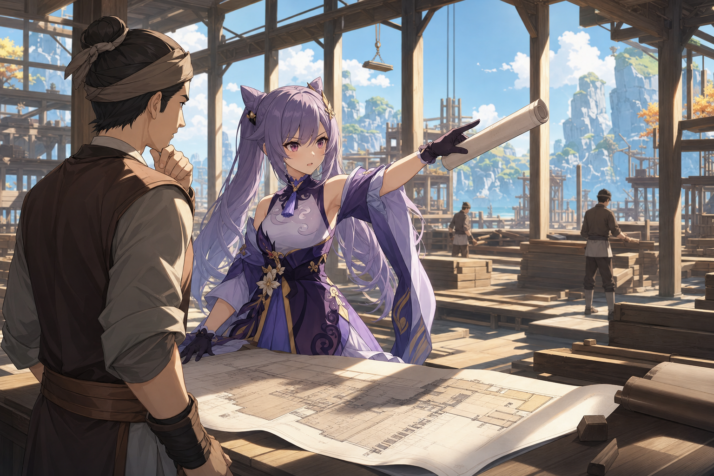

# Example exchange · Keqing / Childhood Friends (English)

> **What this is**: a real, unedited dropline run — one of Keqing's `init-once` opening
> letters, plus the first round of back-and-forth (your reply → Keqing's reply).
>
> **Images**: each one was generated for that turn from its `scene_card`, by the image
> model — not hand-picked.
>
> **Try it yourself**: send the body of message ② to the character's mailbox and you'll
> get this kind of reply back; the subject can be anything.
>
> **Behind the scenes**: under each of Keqing's letters there's a collapsible section
> showing the two-stage pipeline's memory candidates and image prompt — `the LLM proposes,
> the code decides`.

---

## ① Keqing reaches out first · init-once

**Subject:** Recent adjustments at the harbor

It has been a few days since we last spoke. The recent adjustments at the southern wharves took up far more time than I initially allocated. Ningguang and I had differing views on the priority and budget for the warehouse expansions, so I spent the better part of the week personally walking the docks to verify the cargo turnover rates. The matter is finally settled and the new regulations are rolling out, but it has certainly been a demanding stretch.

Whenever I walk past the old stalls near Feiyun Slope to check on the merchants, I occasionally find myself thinking back to when we were younger. It is noticeably quieter without you dragging me over to inspect every newly arrived trinket—though I suppose my current schedule would hardly allow for such detours anyway.

How have your own studies been progressing? I recall you mentioning an upcoming assessment. Do not let the pressure force you into letting the night drag on too long. Complex matters are best handled by breaking the material down into manageable sections, then dealing with the most pressing ones first. A clear head is worth far more than a few extra hours of exhausted reading.

Remember to eat something proper, not just a hasty bite to save time. Write back when you have a moment.

🔍 Behind the scenes · two-stage pipeline

**Inbound**: none — this is an init-once letter; the character reaches out on her own, so there is no incoming mail and no memory is extracted this turn.

**scene_card → image**: a quiet section of the southern wharves in Liyue Harbor · pausing from a cargo manifest near stacked crates to gaze at the ocean · late afternoon, near sunset · briefly nostalgic, quietly satisfied with the day's work.

**Story arc opened (active_arc)**: *Harbor Warehouse Restructuring* — Keqing has just secured the budget and survey for the southern wharves' expansion (after a minor disagreement with Ningguang); the implementation phase is just beginning.

---

## ② Your reply

**Subject:** It's been a while

Keqing,

Sorry it's been so long. Things have been a bit out of hand here — finals are close, and one project had me stuck for almost two weeks. Last night I finally got that endpoint to stop throwing errors, around 3 a.m., completely wiped — but honestly, it felt good.

I just wrapped up one assignment, and there's an exam to study for next week, so I'm a little short of breath, to be honest. I've basically been running on coffee, sleeping at all the wrong hours. If you were here, you'd probably be on my case about it.

Walking by the river near campus tonight, a row of lamps came on along the water, and out of nowhere I remembered us as kids, stomping through puddles together on a rainy day — soaked our pants through, and somehow couldn't have been happier.

You're probably just as busy these days. Even so, remember to rest — keep some balance between work and the rest of life.

— still pulling all-nighters, far from home

---

## ③ Keqing's reply

**Subject:** Re: It's been a while

It has been a while. Reading your letter, I can already see the toll this past half-month has taken on you. You wrestled with that project for weeks, but finally getting that endpoint to stop throwing errors must have been a genuine relief, even at three in the morning. I know that feeling of breaking through a bottleneck well. However, letting the night drag on so late is still a severe drain on your energy.

You guessed correctly—if I were there, I would certainly have a few things to say about your habits. Relying so heavily on coffee while your sleep is in disarray is no long-term strategy. Since the most grueling assignment is behind you, you must use the days before your examination next week to adjust your routine. Go over the material during the day, and let your mind properly recover at night. A clear head will serve you much better than forcing yourself forward on fumes.

As for the lamps along the river... I remember that rainy day clearly. We were thoroughly soaked, and we certainly did not escape a scolding once we got back. It was not the most sensible thing we have ever done, but... I agree, there was an uncomplicated joy in it that is hard to forget.

Things here are busy, but orderly. The implementation phase for the southern wharves' restructuring has begun, and I spent the morning at the site confirming the new storage zones. Moving from the plan on paper to the reality on the docks always brings unexpected details to sort out, but breaking them down step by step keeps everything moving.

I will mind my own rest, as you suggested. See that you actually do the same.

Keqing

🔍 Behind the scenes · two-stage pipeline

**Stage 1 memory candidates pulled from your letter** (the LLM proposes; the code then decides whether — and into which bucket — they're stored):

- `user_episode` The user is currently in the middle of finals, running on coffee and a poor sleep schedule, with an exam coming up next week.
- `user_profile` The user's studies involve programming or software development, as they work with endpoints and code errors.
- `relationship_memory` The user and Keqing used to stomp through puddles together on rainy days when they were kids, getting their clothes soaked but being extremely happy.

**scene_card → image**: inside a half-constructed warehouse at the southern wharves · pointing with a rolled-up blueprint while discussing storage zones with a foreman · mid-morning · focused, authoritative, deep in problem-solving.

**Story arc advanced (active_arc)**: *Harbor Warehouse Restructuring* moves from planning into execution — Keqing is now confirming on-site details, dealing with the friction of turning paper plans into physical reality.

